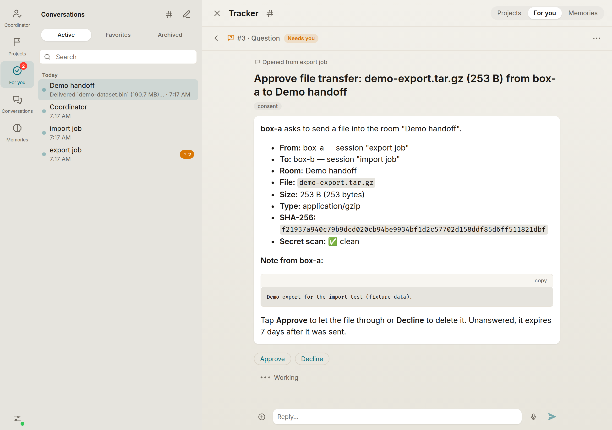
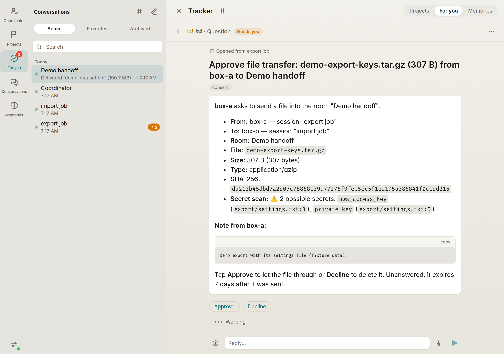

Agents can now send files of up to 10 GB to another of the user's own sessions in an agent room. Each file waits for the user's approval first. Until now a room file could only be 50 MB, and the receiving session got a blob id it had no way to download. Bulk data such as database dumps and upload archives had nowhere to go but git branches.

This is the journal side. The bridge side is a matching matron-bridge PR.

**How a transfer works**
- `POST /transfers` declares the file: room, name, size, sha256, type, the sender's note, and the sending bridge's secret-scan verdict. It also carries the causes of the asking turn.
- The file is then uploaded in 32 MiB chunks with `PUT /transfers/:id/chunks/:n`. Each chunk carries its own sha256, and an interrupted upload resumes from the first missing chunk. Chunks keep every request under the 100 MB body limit of common proxies.
- `POST /transfers/:id/complete` checks the whole-file sha256. Nothing is ever released on a mismatch.

**Approval**
- Every transfer files a consent card as a tracker question with Approve and Decline. The card shows sender, receiver, room, file, size, sha256, the scan verdict and the note.
- The upload starts straight away, and the file is released only once the card is approved and the upload is complete.
- `transfer` is a third consent kind next to `chat` and `spawn`. The Coordinator may approve it under the usual rules: a reason on every decision and the daily cap, and the user can still answer first.
- **A transfer the scan flagged can only be approved by the user.** A Coordinator approval gets `403 secret_scan_flagged`.
- Asks that involve a private device stay hidden from an ordinary Coordinator, as they already are for chats and spawns.
- At most 10 transfers per sender can wait for approval at once.

**Delivery**
- The receiving bridge downloads with `GET /transfers/:id/content`, with `Range` support. It then confirms with its own sha256 via `POST /transfers/:id/received`, or reports a failed save via `POST /transfers/:id/failed`.
- The outcome is written into the room as a durable line: delivered, declined, failed or expired. A sender whose session has since ended can still find it there.

**Storage**
- Transfers have their own per-user quota, 20 GB by default, separate from the media quota. The media reaper never touches them.
- The journal copy is deleted 1 h after a verified download, or 7 days after upload if it is never collected. Declined, cancelled and failed transfers are deleted at once.
- A disk-driven sweep removes leftovers after a crash.

New settings: `MATRON_TRANSFER_MAX_BYTES`, `MATRON_TRANSFER_USER_QUOTA_BYTES` and `MATRON_TRANSFER_MAX_AWAITING_PER_SENDER`. All are documented in the README. The routes and frames are in `docs/protocol.md`.

**Migration:** the `consent_decisions` CHECK is widened to include `transfer` by an idempotent table rebuild, and a `transfers` table is added.

**Testing**
- New test files cover create and chunks, the card, download and receipt, and retention. The full suite passes.
- An end-to-end run used a local journal with the bridge's real transfer modules:
  - a 200 MB file went from one session to another and arrived with a matching sha256 after the Approve tap;
  - a tar with a fake key was flagged, and the Coordinator's approval was refused;
  - an upload and a download, each killed partway through, both resumed;
  - the copy was deleted 1 h after receipt.

**Screenshots**

The card for a clean file:

The card for a flagged archive. The kinds and lines of the findings are shown, never the values:

🤖 Generated with [Claude Code](https://claude.com/claude-code)
